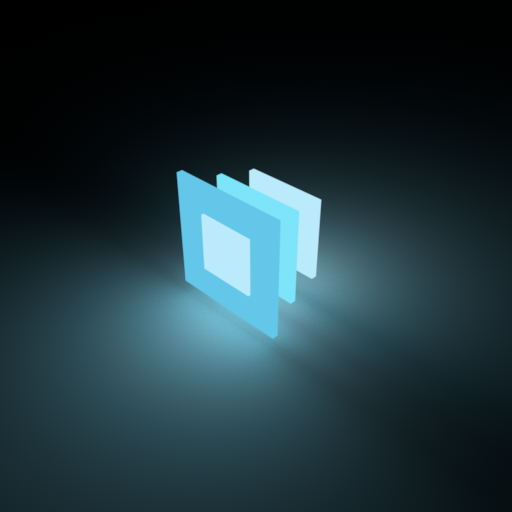
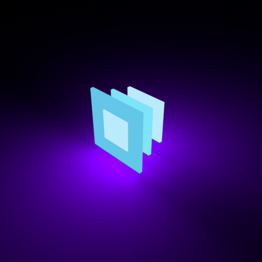
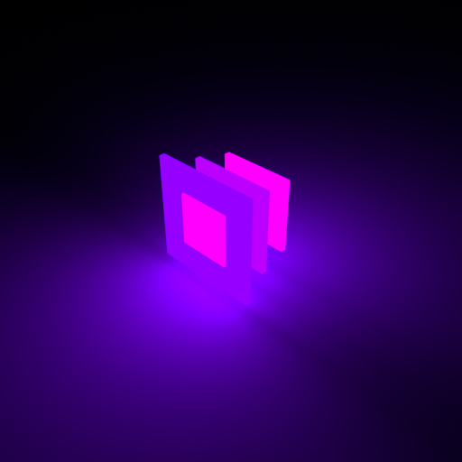
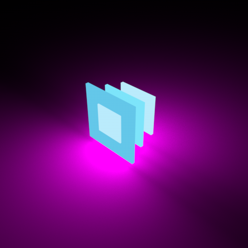
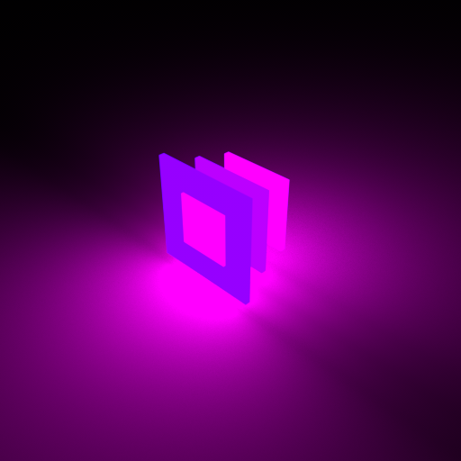
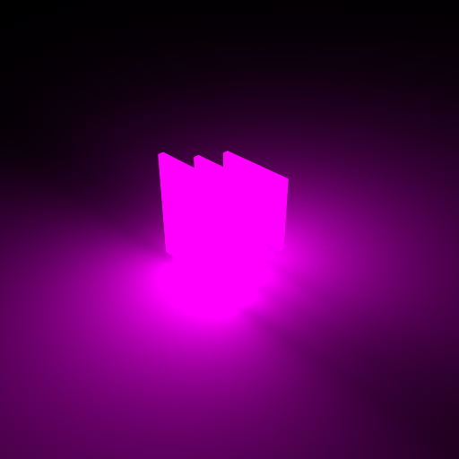
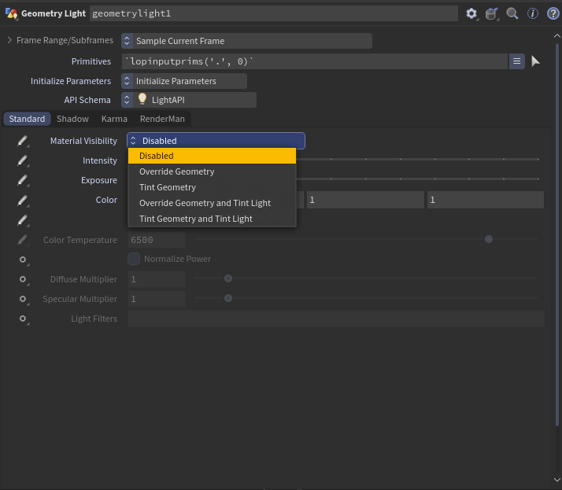

# UsdLux MaterialSyncMode Update

## Background

The LightAPI is an applied API which tags a Prim as being a light emitter and adds attributes to control the light emission of the Prim.

As an applied API this means the Prim may also have a Material bound to it which has its own light emission (e.g. UsdPreviewSurface inputs:emissiveColor). A user can control how the emission of the LightAPI and Material interact via the attribute materialSyncMode.

### Current Schema

```
uniform token light:materialSyncMode = "noMaterialResponse" (
  
displayGroup = "Geometry"

displayName = "Material Sync Mode"

doc = """

For a LightAPI applied to geometry that has a bound Material,which is entirely or partly emissive, this specifies the relationship of the Material response to the lighting response.

Valid values are:

materialGlowTintsLight: All primary and secondary rays see the emissive/glow response as dictated by the bound Material while the base color seen by light rays (which is then modulated by all of the other LightAPI controls) is the multiplication of the color feeding the emission/glow input of the Material (i.e. its surface or volume shader) with the scalar or pattern input to *inputs:color*. This allows the light's color to tint the geometry's glow color while preserving access to intensity and other light controls as ways to further modulate the illumination.

independent: All primary and secondary rays see the emissive/glow response as dictated by the bound Material, while the base color seen by light rays is determined solely by *inputs:color*. Note that for partially emissive geometry (in which some parts are reflective rather than emissive), a suitable pattern must be connected to the light's color input, or else the light will radiate uniformly from the geometry.

noMaterialResponse: The geometry behaves as if there is no Material bound at all, i.e. there is no diffuse, specular, or transmissive response. The base color of light rays is entirely controlled by the *inputs:color*. This is the standard mode for "canonical" lights in UsdLux and indicates to renderers that a Material will either never be bound or can always be ignored.

"""

allowedTokens = ["materialGlowTintsLight", "independent", "noMaterialResponse"]

)
```

The attribute has now started to gain wider use and a few common issues have been identified:

1. The attribute is missing any options which allow a camera visible representation to combine the Material and LightAPI (like how materialGlowTintsLight modulates light rays). The direct camera geometry can only show either the Material or the LightAPI.

2. The documentation language is unclear to users and renderer implementers as to the intended behaviour of each mode. The attribute name and valid values are also not intuitive to users.

3. A further raised concern was to avoid changing the schema in a way that would break existing scenes or require cumbersome backwards compatibility code.

## Proposal

### Propoed Schema

```
uniform token light:materialSyncMode = "noMaterialResponse" (

displayGroup = "Geometry"

displayName = "Material Visibility"

doc = """

When a LightAPI is applied to Prim that has a bound Material (which is entirely or partly emissive) this attribute specifies how the Material appearance should be combined with the LightAPI appearance.

If no Material is bound this setting can be ignored.

The relationship can be applied differently to the camera visible geometry and the lighting output on the rest of the scene.

"Camera Visible Geometry" refers to the directly visible object in an image generated via camera ray hits or rasterizing geometry.

"Lighting Output" refers to the emission from this object which illuminates other objects in the scene via direct illumination, global illumination or indirect rays.

There is some flexibility in how a renderer may decide what is "Camera Visible", for example it may determine that a reflection in a mirror or refraction through glass is "Camera Visible" and should therefore use the "Camera Visible" Material response.

Valid values are:

Disabled (noMaterialResponse): The appearance of both the camera visible geometry and lighting output is determined only by the LightAPI. This is the standard mode for "canonical" lights in UsdLux and indicates to renderers that any bound Material can be ignored.

Override Geometry (independent): The appearance of the camera visible geometry is determined only by the bound Material. The lighting output is determined only by the LightAPI.

Tint Geometry (materialGlowTintsGeometry): The appearance of the camera visible geometry is the bound Material emission multiplied by the emission of the LightAPI. Any non-emissive component (e.g. diffuse/specular surface) should not be affected by the LightAPI. The lighting output is determined only by the LightAPI.

Override Geometry and Tint Light (materialGlowTintsLight): The appearance of the camera visible geometry is determined only by the bound Material. The lighting output is the bound Material emission multiplied by the emission of the LightAPI.

Tint Geometry and Tint Light (materialGlowTints): The appearance of both the camera visible geometry and lighting output is the bound Material emission multiplied by the emission of the LightAPI. Any non-emissive component (e.g. diffuse/specular surface) should not be affected by the LightAPI.

"""

allowedTokens = [
    "materialGlowTintsLight"  
    "materialGlowTintsGeometry"  
    "materialGlowTints"  
    "independent"  
    "noMaterialResponse" 
]

uiHints = {

    displayGroup = "Geometry"  
    displayName = "Material Visibility"  

    dictionary valueLabels = {
        token "Override Geometry and Tint Light" = "materialGlowTintsLight"  
        token "Tint Geometry" = "materialGlowTintsGeometry"  
        token "Tint Geometry and Tint Light" = "materialGlowTints"  
        token "Override Geometry" = "independent"  
        token "Disabled" = "noMaterialResponse"  
    }

    token[] valueLabelsOrder = [
        "Disabled",  
        "Override Geometry",  
        "Tint Geometry",  
        “Override Geometry and Tint Light",  
        “Tint Geometry and Tint Light"
    ]

}

)
```

### Example Render

The following renders show and object which has an emissive blue Material bound and a Magenta colored LightAPI applied.

&nbsp;&nbsp;&nbsp;&nbsp;&nbsp;&nbsp;&nbsp;&nbsp;&nbsp;&nbsp;&nbsp;&nbsp;&nbsp;&nbsp;&nbsp;&nbsp;&nbsp;&nbsp;&nbsp;&nbsp;&nbsp;&nbsp;&nbsp;&nbsp;&nbsp;&nbsp;&nbsp;&nbsp;&nbsp;&nbsp;&nbsp;&nbsp;

| | |&nbsp;&nbsp;&nbsp;&nbsp;&nbsp;&nbsp;&nbsp;&nbsp;&nbsp;&nbsp;&nbsp;&nbsp;&nbsp;&nbsp;&nbsp;&nbsp;&nbsp;&nbsp;&nbsp;&nbsp;&nbsp;&nbsp;&nbsp;&nbsp;&nbsp;&nbsp;&nbsp;&nbsp;&nbsp;&nbsp;&nbsp;&nbsp; | &nbsp;&nbsp;&nbsp;&nbsp;&nbsp;&nbsp;&nbsp;&nbsp;&nbsp;&nbsp;&nbsp;&nbsp;&nbsp;&nbsp;&nbsp;&nbsp;&nbsp;&nbsp;&nbsp;&nbsp;&nbsp;&nbsp;&nbsp;&nbsp;&nbsp;&nbsp;&nbsp;&nbsp;&nbsp;&nbsp;&nbsp;&nbsp;<br>**Camera Visible Geometry** | &nbsp;&nbsp;&nbsp;&nbsp;&nbsp;&nbsp;&nbsp;&nbsp;&nbsp;&nbsp;&nbsp;&nbsp;&nbsp;&nbsp;&nbsp;&nbsp;&nbsp;&nbsp;&nbsp;&nbsp;&nbsp;&nbsp;&nbsp;&nbsp;&nbsp;&nbsp;&nbsp;&nbsp;&nbsp;&nbsp;&nbsp;&nbsp; |
| :---: | :---: | :---: | :---: | :---: |
| | | Material | Material x LightAPI | LightAPI |
| | Material | <br>**Reference**<br>No LightAPI | No Option | No Option |
| **Lighting Output** | Material x LightAPI | <br>**Override Geometry and Tint Light**<br>materialGlowTintsLight | <br>**Tint Geometry and Tint Light**<br>materialGlowTints (NEW) | No Option |
| | LightAPI | <br>**Override Geometry**<br>independent | <br>**Tint Geometry**<br>materialGlowTintsGeometry (NEW) | <br>**Disabled**<br>noMaterialResponse |

### Example DCC UI



### Description

#### New Options

Two new modes are added: `materialGlowTintsGeometry` and `materialGlowTints`

These add the missing tinted camera visible representations (with lighting response determined by the LightAPI and the Material tinted LightAPI respectively). These new modes are additive so should not break existing USD scenes.

#### UI Hints

UI hints are added to give the user a better guide to each options functionality without changing the actual values and therefore breaking backwards compatibility.

The display name changes from **"Material Sync Mode"** to **“Material Visibility"**.  
This better reflects the fact that the attribute handles whether to show, mix or hide the Material (in either of our viewing contexts).

The options now have a `valueLabel` to give a more intuitive user interfaces for each option.  
- Unless the label specifies that the Material is "overriding", the LightAPI is always contributing.  
- **“Override"** denotes that the Material is used and the LightAPI is ignored.  
- **“Tint Geometry"** / **"Tint Light”** denote that the Material's emission multiplies with the LightAPI's emission.  
- **“Geometry”** denotes the camera visible representation.  
- **"Light"** denotes the lighting output.  
- When **“Light”** is not mentioned, the LightAPI alone controls the lighting output.  

#### Documentation

Finally the documentation language is updated to be clearer to both users and renderer implementers of the correct output. 

References to "primary and secondary rays” and “light rays” have been replaced with “camera visible representation” and “light output on the scene”, with definitions which are more inclusive to different types of renderers. 

This is a complicated attribute for renderers to implement, so some flexibility is built into the definition. Different raytracers/rasterizers will have completely different challenges implementing this. We try to clearly define the intention but let renderers handle the details of their implementation.

### Caveats

We still are missing three possible modes within the space of possiblities. If we find a strong demand for these modes they can be added at a later date without breaking backwards compatibility.

We should also acknowledge that the UI hints no longer exactly match the actual values. However this is a trade off for backwards compatibility, with the intention of the UI hints is to provide exactly this type of functionality.

Finally providing renderers some flexibility is slightly at odds with the idea of standardising lighting via the UsdLux schema. However this is a complicated setting for renderers to implement. We don’t want to close USD/Hydra from certain renderer designs. There will likely already be a lot of variance in mesh lights appearance across renderers.

### Alternative Proposals

#### Split the Attribute
An alternative solution would be to split materialSyncMode into two options. One controls the camera visible appearance and one controls the lighting output. These could either be checkboxes or enumerated options.

This would be clearer to the user which context was changing and offer the full range of options. However this would come at the price of backwards compatibility.

#### Longer Labels
Another suggestion would be to attempt to fully explain the effect in the valueLabels, rather than using the assumption that the LightAPI applies and describing how the Material works.

For example:  
- independent = "Material Tints Geometry / Light Tints Glow"  
- materialGlowTintsLight = "Material Tints Geometry / Light and Material Tints Glow".

However these valueLabels may be too long for certain UI to accomodate and that more verbose description may be better left to the documentation.